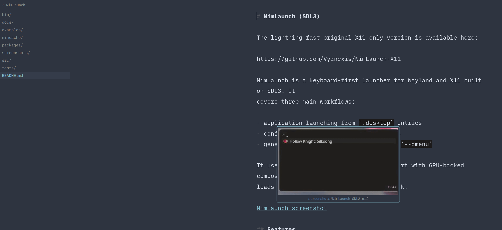
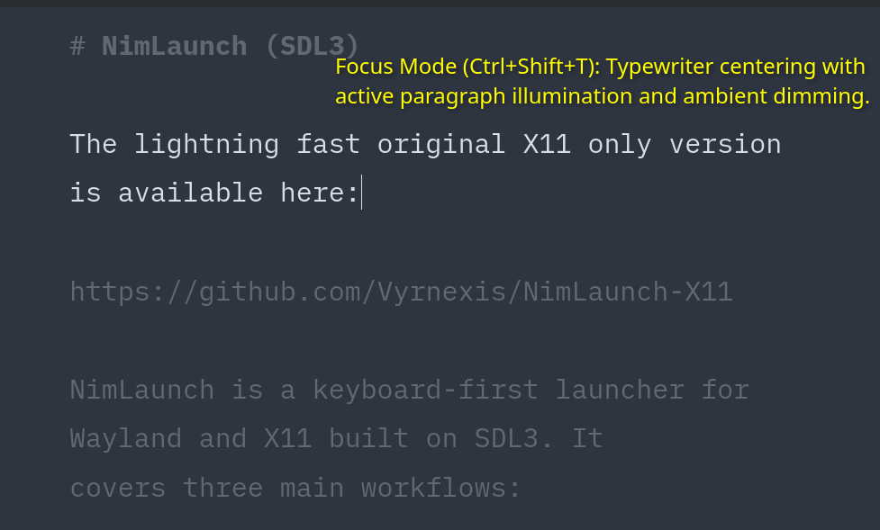
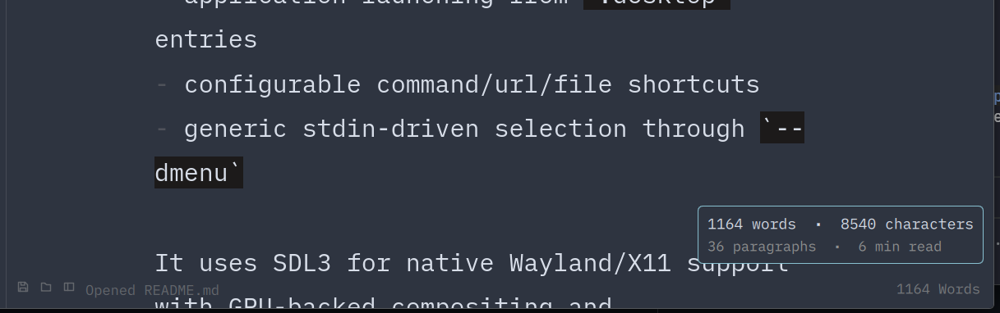
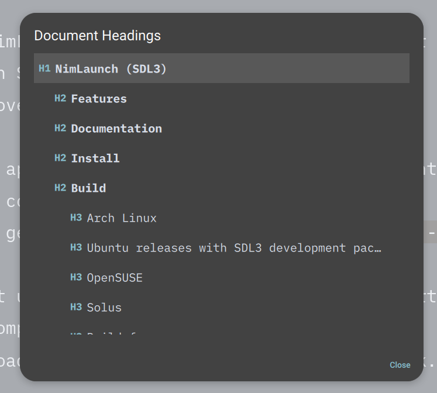
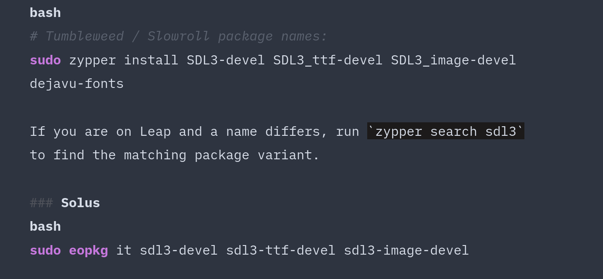

# Omawrite Standalone

A minimal, distraction-free Markdown writing application built with Qt Quick and C++.

Originally based on [omacom-io/omawrite](https://github.com/omacom-io/omawrite), **Omawrite Standalone** uses native Qt window controls and optional Linux desktop-portal integration. Other Qt 6 platforms fall back to Qt's system appearance support without requiring D-Bus.



<p align="center">
  
  
</p>

<p align="center">
  
  
</p>

---

## Features & Enhancements

### Ported Upstream Pull Requests
We have ported and integrated key upstream pull requests from [omacom-io/omawrite](https://github.com/omacom-io/omawrite/pulls):
- **[PR #8](https://github.com/omacom-io/omawrite/pull/8): Markdown link URLs on hover** — Hovering over Markdown links shows destination targets with `Ctrl+Click` to open in browser.
- **[PR #9](https://github.com/omacom-io/omawrite/pull/9): Fix false unsaved changes** — Prevents false-positive modified dirty state on unmodified documents.
- **[PR #12](https://github.com/omacom-io/omawrite/pull/12): Smart Return line breaks** — Automatically continues numbered, bulleted, and blockquote lists on `Enter`.
- **[PR #13](https://github.com/omacom-io/omawrite/pull/13): Robust new file handling** — Clean file lifecycle handling across new windows and uncommitted buffers.
- **[PR #15](https://github.com/omacom-io/omawrite/pull/15): Strikethrough formatting** — Adds `Ctrl+Shift+X` markdown strikethrough (`~~text~~`) with smart wrap/unwrap logic.
- **[PR #17](https://github.com/omacom-io/omawrite/pull/17): Focus mode** — Adds typewriter scrolling and paragraph dimming via `Ctrl+Shift+T`.
- **[PR #18](https://github.com/omacom-io/omawrite/pull/18): Viewport clamp** — Prevents editor clipping and horizontal text overflow in narrow window sizes.
- **[PR #22](https://github.com/omacom-io/omawrite/pull/22): File explorer sidebar** — Adds collapsible folder file tree view via `Ctrl+E`.

### Standalone Exclusive Features
- **Distro-Independent & Portal Theming:** Native desktop integration via standard XDG desktop portals or standalone config without requiring Omarchy D-Bus services.
- **Document Heading Navigation HUD (`Ctrl+Shift+O`):** Popover outline of all document headings (`#` through `######`) with instant top-aligned scrolling.
- **Image & Animated GIF Hover Previews:** Hovering over Markdown images (``) or HTML `` tags displays a scaled popover supporting local files, remote URLs, and looping animated GIFs.
- **Auto-Pairing & Selection Wrapping:** Automatically pairs brackets `()`, `[]`, `{}`, quotes `""`, `''`, and wraps highlighted selections without interfering with triple-backtick fences.
- **Interactive Task Lists:** Smart `- [ ]` and `- [x]` task continuation on `Enter`, with instant toggling via `Ctrl+Shift+C`.
- **Extended Writing Statistics HUD:** Hovering over the bottom-right word count reveals a detailed card with word count, character count, paragraph count, and reading time.
- **Dynamic Text Zooming HUD:** Zoom in and out dynamically (`Ctrl++` / `Ctrl+-` / `Ctrl+0`) with a transient visual scale overlay.
- **Live TOML Theming & Custom Fonts:** Supports live-reloading colors and fonts via `~/.config/omawrite/config.toml`.
- **Syntax Highlighting for 8 Languages:** Native code block syntax highlighting for Bash, C, C++, JavaScript, JSON, Nim, Python, Ruby, and TOML.

---

## Configuration & Theming

Omawrite Standalone supports live hot-reloading via `~/.config/omawrite/config.toml` without requiring an application restart.

```toml
# Omawrite Custom Theme & Configuration

# Text scaling factor (1.0 is default)
text_scale = 1.0

# Font family (default: "iA Writer Mono S")
font_family = "iA Writer Mono S"

# --- Tokyo Night Theme Example ---
background = "#1a1b26"
foreground = "#c0caf5"
accent     = "#7aa2f7"
selection  = "#33467c"
```

---

## Keyboard Shortcuts

| Shortcut | Action |
| :--- | :--- |
| `Ctrl+S` | Save Document |
| `Ctrl+Shift+S` | Save As |
| `Ctrl+O` | Open File |
| `Ctrl+E` | Toggle Folder Sidebar |
| `Ctrl+Shift+O` | Document Heading Navigation HUD |
| `Ctrl+Shift+T` | Toggle Focus Mode (Typewriter Centering) |
| `Ctrl+Shift+C` | Toggle Task Checkbox (`- [ ]` / `- [x]`) |
| `Ctrl+B` | Toggle Bold (`**text**`) |
| `Ctrl+I` | Toggle Italic (`*text*`) |
| `Ctrl+Shift+X` | Toggle Strikethrough (`~~text~~`) |
| `Ctrl+K` | Insert Markdown Link |
| `Ctrl+F` | Find in Document (`Enter` / `Shift+Enter` for next/prev) |
| `Ctrl+H` | Find and Replace |
| `Ctrl++` / `Ctrl+-` | Zoom In / Out |
| `Ctrl+0` | Reset Zoom (100%) |
| `F11` / `Super+F` | Toggle Fullscreen |
| `Ctrl+N` | Open New Window |
| `Ctrl+P` | Print Document |
| `Ctrl+Z` / `Ctrl+Shift+Z` | Undo / Redo |
| `Ctrl+?` | Display Keyboard Shortcut HUD |
| `Ctrl+Q` / `Ctrl+W` | Quit / Close Window |

---

## Building from Source

### Prerequisites
- Qt 6 libraries (`qt6-base`, `qt6-declarative`, `qt6-quickcontrols2`)
- `qmake` or `qmake6`
- C++17 compatible compiler (`g++` or `clang++`)
- `make`

### Compilation
```bash
git clone https://github.com/Vyrnexis/Omawrite-Standalone.git
cd Omawrite-Standalone

# Build an optimized release binary into ./bin/
qmake6 omawrite.pro
make -j"$(nproc)"

# Run
./bin/omawrite
```

---

## Upstream & Acknowledgements
- Forked from [omacom-io/omawrite](https://github.com/omacom-io/omawrite).
- The bundled `iA Writer Mono` font is licensed under the SIL Open Font License 1.1 (see `fonts/OFL.txt`), copyright Information Architects Inc., based on IBM Plex (copyright IBM Corp.).
